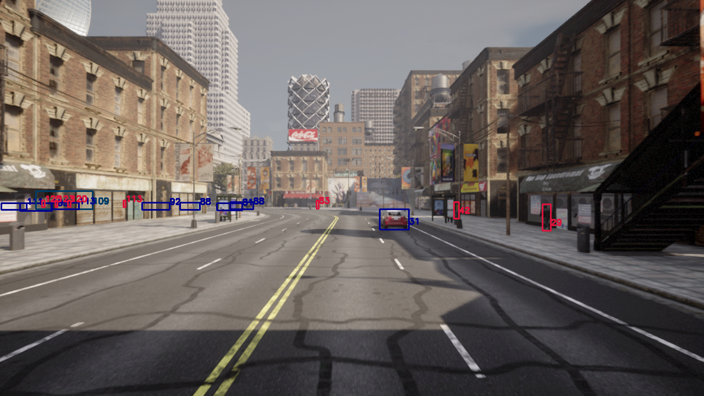
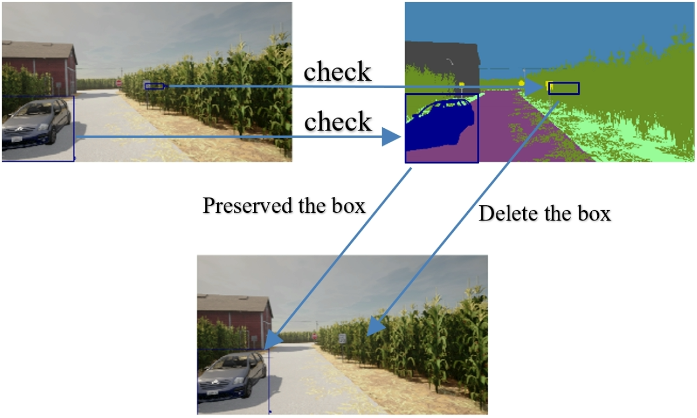
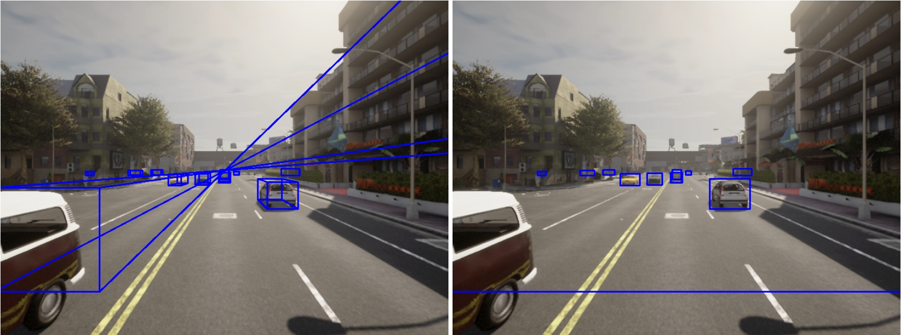

# Improving Bounding Box in CARLA Simulator
This work is divided into two main parts:<br>
**- Improving the bounding box in the CARLA simulator**<br>
**- Improving CARLA simulator tools to generate flexible environments using YAML files**<br>
In this README, we explain the first part (improving the bounding box in the CARLA simulator) as well as the second part.<br>
**For any question, please do not hesitate to contact us at:**
<a href="mailto:mohamadmofeed.chaar@th-ab.de">mohamadmofeed.chaar@th-ab.de</a>

## Citation

If you use this dataset or our implementation in this project, please cite this publication:<br>
```
@conference{vehits24,
author={Mohamad Chaar. and Jamal Raiyn. and Galia Weidl.},
title={Improve Bounding Box in Carla Simulator},
booktitle={Proceedings of the 10th International Conference on Vehicle Technology and Intelligent Transport Systems - VEHITS},
year={2024},
pages={267-275},
publisher={SciTePress},
organization={INSTICC},
doi={10.5220/0012600500003702},
isbn={978-989-758-703-0},
issn={2184-495X},
}
```

## Folder Structure
📦root<br>
 ┣ 📂carlasimu --> Contains the tools to generate datasets.<br>
 ┃ ┣ 📂yaml_files --> Contains all YAML files that control the CARLA simulator environment.<br>
 ┃ ┃ ┣ boundingBox.yaml --> Contains all the parameters related to the bounding box.<br>
 ┃ ┃ ┣ color_segmentation.yaml --> RGB colors of the objects, see the [link](https://carla.readthedocs.io/en/latest/ref_sensors/#semantic-segmentation-camera).<br>
 ┃ ┃ ┣ data.yaml --> Data of the CARLA environment.<br>
 ┃ ┃ ┣ mapLayer.yaml --> Boolean parameters to remove the buildings or the parked vehicles.<br>
 ┃ ┃ ┣ sensors.yaml --> Sensor parameter settings.<br>
 ┃ ┃ ┣ vehicles_name.yaml --> Names of the vehicles in the CARLA simulator, see the [link](https://carla.readthedocs.io/en/latest/catalogue_vehicles/).<br>
 ┃ ┃ ┗ weather.yaml --> Weather parameters, see the [link](https://carla.readthedocs.io/en/latest/python_api/#carlaweatherparameters).<br>
 ┃ ┃<br>
 ┃ ┣ ActorController.py --> Controls the actors **(do not change the code; all the controllers can be configured through the YAML files, as we will see later).**<br>
 ┃ ┣ Actors.py --> Spawns the actors in the environment (do not change the code).<br>
 ┃ ┣ BoundingBox.py --> Calculates the bounding boxes of objects and filters out the unwanted boxes (do not change the code).<br>
 ┃ ┣ Manager.py --> Manages the environment (do not change the code).<br>
 ┃ ┣ carlaUtils.py --> Utility tools for the code (do not change the code).<br>
 ┃ ┣ config.py --> Opens the YAML files (do not change the code).<br>
 ┃ ┣ exceptions.py --> Handles the exceptions (do not change the code).<br>
 ┃ ┣ sensors.py --> Installs the sensors (do not change the code).<br>
 ┃ ┗ weather.py --> Controls the weather conditions (do not change the code).<br>
 ┃<br>
 ┣ 3D_Bounding_Box.py --> Generates data with 3D bounding box annotations.<br>
 ┗ boundingBox.py --> Generates data with 2D bounding box annotations.<br>

## Filtering Bounding Boxes
In the CARLA simulator, generating datasets with bounding box annotations suffers from a problem: it does not take into account objects that are hidden behind obstacles, as in the image below.<br>
<br>
Bounding boxes before the filter<br>

We call these boxes `Ghost boxes`.<br>
Our work in this project filters out the boxes that should be deleted.
We use a semantic segmentation camera in the CARLA simulator to filter the boxes by comparing the colors of the segmentation image with the class of the object inside each box. See the semantic segmentation colors of the CARLA simulator [here](https://carla.readthedocs.io/en/latest/ref_sensors/#semantic-segmentation-camera).<br>
**The image below** shows our methodology for filtering the boxes using the semantic segmentation sensor.<br>
<br>
<strong>Figure 1:</strong> In this filter, we check in the semantic segmentation image whether each box contains at least 10% of the color corresponding
to the object. In our example, the
color of the car in CARLA's semantic segmentation is (0, 0,
142). The small box behind the fence is hidden, and there is
no pixel with the value (0, 0, 142) inside it, in contrast to
the bounding box of the car in the large box.<br>
<br><br>

### Boxes covering a significant portion of the image
Our work also solves the problem of 2D bounding boxes that cover a significant portion of the image, and the "beam" effect of 3D boxes caused by negative coordinates of the bounding box, as shown in the image below.<br>
<figure>
    <br>
    <figcaption><strong>Figure 2:</strong> The effect of negative coordinates on the bounding
boxes of objects. For the 3D bounding box, the box appears
as a beam (left). For the 2D bounding box (right
image), the box should contain the vehicle (in the
right corner of the image), but instead it
covers a significant portion of the entire image.</figcaption>
</figure><br><br>

## Generating the Data
To create more flexible environments with various factors, such as the number of vehicles, pedestrians, and weather conditions, we developed our `carlasimu` package.<br>
You can control these environmental elements through parameters defined in **YAML files**.<br>
`carlasimu` is not intended only for data generation; developers can also use it to run custom environments tailored to their specific needs.<br>
Our project focuses on generating data from image sensors with 2D and 3D bounding box annotations for six object categories: cars, buses, trucks, vans, pedestrians, and traffic lights. Additionally, the system can be extended to collect data from other sensor modalities, including LiDAR, radar, depth cameras, and semantic segmentation cameras.

### YAML Files
The YAML files are located in `root/carlasimu/yaml_files`.<br>

### data.yaml
<table style="width:100%">
  <tr>
    <td><strong>Parameter</strong></td>
    <td><strong>Value</strong></td>
    <td><strong>Description</strong></td>
  </tr>
  <tr>
    <td>number_of_wheels</td>
    <td>str: '2', '4', 'All'. Default is '4'</td>
    <td>The number of wheels of the vehicles. If you set it to '2', all the vehicles will be motorcycles and bicycles.</td>
  </tr>
  <tr>
    <td>generationv</td>
    <td>str: '1', '2', 'All'. Default is 'All'</td>
    <td>Restricts the vehicles to a certain generation.</td>
  </tr>
  <tr>
    <td>generationw</td>
    <td>str: '1', '2', 'All'. Default is 'All'</td>
    <td>Restricts the walkers to a certain generation.</td>
  </tr>
  <tr>
    <td>number_of_vehicles</td>
    <td>int: Default is 150</td>
    <td>Number of vehicles in the environment.</td>
  </tr>
  <tr>
    <td>number_of_walkers</td>
    <td>stand: int, walk: int, run: int. Default is 0 for each</td>
    <td>Number of standing walkers, walking walkers, and running walkers.</td>
  </tr>
  <tr>
    <td>car_lights_on</td>
    <td>boolean: Default is False</td>
    <td>Enables automatic car light management.</td>
  </tr>
  <tr>
    <td>hero</td>
    <td>boolean: Default is True</td>
    <td>Sets one of the vehicles as the hero (ego) vehicle.</td>
  </tr>
  <tr>
    <td>respawn</td>
    <td>boolean: Default is True</td>
    <td>Automatically respawns dormant vehicles (only in large maps).</td>
  </tr>
  <tr>
    <td>light_state</td>
    <td>boolean for each of the following lights: [ALL, Position, LowBeam, HighBeam, Brake, RightBlinker, LeftBlinker, Reverse, Fog, Interior, Special1, Special2]</td>
    <td>Light state of the vehicles. The default is False; each light set to True will be turned on. If you set 'ALL' to True, all the lights will be turned on and the rest of the values are ignored.</td>
  </tr>
</table><br>

**The rest of the parameters follow the CARLA settings.**<br>

### sensors.yaml
This file provides comprehensive control over the sensor parameters, allowing you to tailor data collection to your specific needs. For more details, [click here](https://carla.readthedocs.io/en/latest/ref_sensors/).<br>

### boundingBox.yaml
This file is essential for collecting datasets. If you want to generate a dataset with a variety of sensors, you have to set up the parameters of this file as follows.<br>
**- cam_rgb**<br>
<table style="width:100%">
  <tr>
    <td><strong>Parameter</strong></td>
    <td><strong>Value</strong></td>
    <td><strong>Description</strong></td>
  </tr>
  <tr>
    <td>save_to_file</td>
    <td>boolean: Default is True</td>
    <td>If False, no image data will be saved.</td>
  </tr>
  <tr>
    <td>save_dir</td>
    <td>str: Default is 'out\cam'</td>
    <td>Directory to save the files.</td>
  </tr>
  <tr>
    <td>bbox_dir</td>
    <td>str: Default is 'out\bbox'</td>
    <td>Bounding box directory.</td>
  </tr>
  <tr>
    <td>path_save</td>
    <td>str: Default is 'box'</td>
    <td>The path to save the image data.</td>
  </tr>
  <tr>
    <td>3D</td>
    <td>boolean: Default is False</td>
    <td>If False, the bounding box will be 2D.</td>
  </tr>
  <tr>
    <td>figure_in_window</td>
    <td>boolean: Default is True</td>
    <td>True means the vehicle is shown in a window while it is driving.</td>
  </tr>
  <tr>
    <td>filter</td>
    <td>boolean: Default is True</td>
    <td>Filters out occluded objects.</td>
  </tr>
  <tr>
    <td>max_distance</td>
    <td>int: Default is 50 (in meters)</td>
    <td>Maximum distance for labeling objects with boxes.</td>
  </tr>
  <tr>
    <td>min_distance</td>
    <td>int: Default is 1 (in meters)</td>
    <td>Minimum distance for labeling objects with boxes.</td>
  </tr>
  <tr>
    <td>actors</td>
    <td>vehicles: boolean, walkers: boolean. Default is True for both</td>
    <td>If False, the camera will not label vehicles or walkers with bounding boxes.</td>
  </tr>
  <tr>
    <td>num_image</td>
    <td>int: Default is 1000</td>
    <td>The number of images to save. When it finishes, the CARLA environment will be closed.</td>
  </tr>
</table><br>

**- image_segmentation**<br>
<table style="width:100%">
  <tr>
    <td><strong>Parameter</strong></td>
    <td><strong>Value</strong></td>
    <td><strong>Description</strong></td>
  </tr>
  <tr>
    <td>save_to_file</td>
    <td>boolean: Default is True</td>
    <td>If False, no image data will be saved.</td>
  </tr>
  <tr>
    <td>save_dir</td>
    <td>str: Default is 'out\seg'</td>
    <td>Directory to save the files.</td>
  </tr>
  <tr>
    <td>figure_in_window</td>
    <td>boolean: Default is False</td>
    <td>True means the sensor output is shown in a window.</td>
  </tr>
</table><br>

**- radar_sensor**<br>
<table style="width:100%">
  <tr>
    <td><strong>Parameter</strong></td>
    <td><strong>Value</strong></td>
    <td><strong>Description</strong></td>
  </tr>
  <tr>
    <td>save_to_file</td>
    <td>boolean: Default is False</td>
    <td>If False, no data will be saved for this sensor.</td>
  </tr>
  <tr>
    <td>save_dir</td>
    <td>str: Default is 'out\radar'</td>
    <td>Directory to save the files.</td>
  </tr>
  <tr>
    <td>figure_in_window</td>
    <td>boolean: Default is False</td>
    <td>True means the sensor output is shown in a window.</td>
  </tr>
</table><br>

**- lidar_sensor**<br>
<table style="width:100%">
  <tr>
    <td><strong>Parameter</strong></td>
    <td><strong>Value</strong></td>
    <td><strong>Description</strong></td>
  </tr>
  <tr>
    <td>save_to_file</td>
    <td>boolean: Default is False</td>
    <td>If False, no data will be saved for this sensor.</td>
  </tr>
  <tr>
    <td>save_dir</td>
    <td>str: Default is 'out\lidar'</td>
    <td>Directory to save the files.</td>
  </tr>
  <tr>
    <td>figure_in_window</td>
    <td>boolean: Default is False</td>
    <td>True means the sensor output is shown in a window.</td>
  </tr>
</table><br>

**- depth_image_sensor**<br>
<table style="width:100%">
  <tr>
    <td><strong>Parameter</strong></td>
    <td><strong>Value</strong></td>
    <td><strong>Description</strong></td>
  </tr>
  <tr>
    <td>save_to_file</td>
    <td>boolean: Default is False</td>
    <td>If False, no data will be saved for this sensor.</td>
  </tr>
  <tr>
    <td>save_dir</td>
    <td>str: Default is 'out\depth'</td>
    <td>Directory to save the files.</td>
  </tr>
  <tr>
    <td>figure_in_window</td>
    <td>boolean: Default is False</td>
    <td>True means the sensor output is shown in a window.</td>
  </tr>
</table><br>

**- threshold_small_box**<br>
int: Default is 10. The default threshold for vehicle detection is 10%.<br>
This means that if at least 10% of the pixels within a box belong to the vehicle, the system considers it a valid detection and does not filter it out.<br>
**- size_big_box**<br>
int: Default is 70. This value determines whether a box is considered "big". Boxes that occupy more than 70% of the entire image are filtered with another threshold, called `threshold_big_box`, as they are likely to represent the entire scene rather than a specific object (see Figure 2).<br>
**- threshold_big_box**<br>
int: Default is 50. The default threshold for vehicle detection in big boxes is 50%.<br>
This means that if at least 50% of the pixels within a big box belong to the vehicle, the system considers it a valid detection and does not filter it out.<br>
**- time_screen_shot**<br>
int: Default is 1. The data saving interval is 1 second, which means an image is captured and saved to the dataset every second.<br>

### color_segmentation.yaml
The colors of the CARLA semantic segmentation classes (do not change them).<br>

### mapLayer.yaml
**building** boolean: Default is True. If you set it to False, the buildings will disappear from the CARLA map.<br>
**ParkedVehicles** boolean: Default is False. If you set it to True, the parked vehicles will appear on the CARLA map.<br>

### vehicles_name.yaml
The names of the vehicles in the CARLA simulator (do not change them).<br>

### weather.yaml
Sets the values of the weather parameters, [see the link](https://carla.readthedocs.io/en/latest/python_api/#carlaweatherparameters).<br>

<details open>
<summary>Python API</summary>

## Environment
```python
carlasimu.carlaUtils.CarlaEnvironment(host, port, maps, set_timeout)
```

### Parameters
<table style="width:100%">
  <tr>
    <td><strong>Parameter</strong></td>
    <td><strong>Value</strong></td>
    <td><strong>Description</strong></td>
  </tr>
  <tr>
    <td>host</td>
    <td>str: Default is '127.0.0.1' or the value of host in data.yaml</td>
    <td>You can change the default value with the host parameter in data.yaml.</td>
  </tr>
  <tr>
    <td>port</td>
    <td>int: Default is 2000 or the value of port in data.yaml</td>
    <td>You can change the default value with the port parameter in data.yaml.</td>
  </tr>
  <tr>
    <td>maps</td>
    <td>str: Default is 'Town10HD_Opt' or the value of maps in data.yaml</td>
    <td>The name of the CARLA map to load.</td>
  </tr>
  <tr>
    <td>set_timeout</td>
    <td>float: Default is 15.0 or the value of set_timeout in data.yaml</td>
    <td>You can change the default value with the set_timeout parameter in data.yaml.</td>
  </tr>
</table><br>

### Variables
- host
- port
- set_timeout
- carla (the CARLA package), [click here](https://carla.readthedocs.io/en/latest/python_api/)
- client (for more details, [click here](https://carla.readthedocs.io/en/latest/python_api/#carlaclient))
- world (for more details, [click here](https://carla.readthedocs.io/en/latest/python_api/#carlaworld))
- synchronous_master
- traffic_manager (for more details, [click here](https://carla.readthedocs.io/en/latest/python_api/#carlatrafficmanager))

## Manager
```python
carlasimu.Manager.CarlaManager(CarlaEnvironment)
```
**Usage**<br>

```python
from carlasimu.carlaUtils import CarlaEnvironment
from carlasimu.Manager import CarlaManager

map_name = 'Town10HD_Opt'
env = CarlaEnvironment(maps=map_name)
client = env.client
world = env.world
carla = env.carla
manager = CarlaManager(env)
```

### Functions
- **ActorController():** returns carlasimu.ActorController.Controller()
- **weather():** returns carlasimu.weather.weather(env)
- **vehicles():** returns carlasimu.Actors.vehicles(env)
- **walkers():** returns carlasimu.Actors.walkers(env)
- **BoundingBox():** returns carlasimu.BoundingBox.BoundingBox(env)
- **sensors():** returns carlasimu.sensors.sensors(env)<br>

## Weather

```python
carlasimu.weather.weather(CarlaEnvironment)
```
When you call it, all the weather parameters are loaded from the weather.yaml file.<br>
**Python code**<br>

```python
weather = manager.weather()
weather.set_weather()
```

### Variables
**default_weather:** the default weather before the weather is updated.

### Functions
**set_weather(weather=None):** applies the weather parameters (from weather.yaml by default).<br>
**get_weather_parameter():** returns the weather parameters from the weather.yaml file.<br>
**set_default_weather():** changes the weather to the default weather of the map.<br>
**get_weather():** returns the weather of the running map.<br>

## Vehicles
### Usage
```python
vehicle = manager.vehicles()
vehicles_list = vehicle.set_vehicles(same_number=True)
```

### Functions
**set_vehicles(blueprints=None, number_of_vehicles=None, number_of_wheels=None, same_number=False, hero=None, main_function=True)**<br>
**Parameters:**
<table style="width:100%">
  <tr>
    <td><strong>Parameter</strong></td>
    <td><strong>Value</strong></td>
    <td><strong>Description</strong></td>
  </tr>
  <tr>
    <td>blueprints</td>
    <td>blueprints: Default is None</td>
    <td>If None, the blueprints are generated automatically.</td>
  </tr>
  <tr>
    <td>number_of_vehicles</td>
    <td>int: Default is the value of <strong>number_of_vehicles</strong> in data.yaml</td>
    <td>Number of vehicles to spawn.</td>
  </tr>
  <tr>
    <td>number_of_wheels</td>
    <td>str: Default is the value of <strong>number_of_wheels</strong> in data.yaml</td>
    <td>The values are '2', '4', or 'All', which describe the number of wheels of the vehicles in the environment (see the YAML Files section).</td>
  </tr>
  <tr>
    <td>same_number</td>
    <td>boolean: Default is False</td>
    <td>When placing vehicles in the simulation, a vehicle is rejected if a collision occurs during spawning. This can lead to fewer vehicles than expected. To make sure the desired number is reached, set "same_number" to True. The simulator will then keep trying to place the vehicles until there are no conflicts.</td>
  </tr>
  <tr>
    <td>hero</td>
    <td>boolean: Default is the value of <strong>hero</strong> in data.yaml</td>
    <td>True: there is a hero (ego) vehicle.</td>
  </tr>
  <tr>
    <td>main_function</td>
    <td>boolean: Default is True (<strong>do not change it</strong>)</td>
    <td></td>
  </tr>
</table><br>

## Walkers
### Usage
```python
walker = manager.walkers()
walkers = walker.set_walkers(same_number=True, activate_actors=True)
```

### Functions
**set_walkers(blueprintsWalkers=None, number_walkers=None, same_number=True, activate_actors=True, main_function=True)**<br>
**Parameters:**
<table style="width:100%">
  <tr>
    <td><strong>Parameter</strong></td>
    <td><strong>Value</strong></td>
    <td><strong>Description</strong></td>
  </tr>
  <tr>
    <td>blueprintsWalkers</td>
    <td>blueprints: Default is None</td>
    <td>If None, the blueprints are generated automatically.</td>
  </tr>
  <tr>
    <td>number_walkers</td>
    <td>list of int: Default is the value of <strong>number_of_walkers</strong> in data.yaml</td>
    <td>The list is [stand, walk, run].</td>
  </tr>
  <tr>
    <td>same_number</td>
    <td>boolean: Default is True</td>
    <td>When placing walkers in the simulation, a walker is rejected if a collision occurs during spawning. This can lead to fewer walkers than expected. To make sure the desired number is reached, set "same_number" to True. The simulator will then keep trying to place the walkers until there are no conflicts.</td>
  </tr>
  <tr>
    <td>activate_actors</td>
    <td>boolean: Default is True</td>
    <td>False: the walkers will not be activated.</td>
  </tr>
  <tr>
    <td>main_function</td>
    <td>boolean: Default is True (<strong>do not change it</strong>)</td>
    <td></td>
  </tr>
</table><br>

## Sensors
### Usage
```python
camera_bp, cam_transform = manager.sensors().set_rgb_camera()
camera = world.spawn_actor(camera_bp, cam_transform, attach_to=ego)
image_queue = queue.Queue()
camera.listen(image_queue.put)
```

### Functions
**set_rgb_camera(attributes=None):** sets up the RGB camera sensor and returns blueprint, transform.<br>
**set_seg_camera(attributes=None):** sets up the semantic segmentation camera sensor and returns blueprint, transform.<br>
**radar_sensor(attributes=None):** sets up the radar sensor and returns blueprint, transform.<br>
**lidar_sensor(attributes=None):** sets up the LiDAR sensor and returns blueprint, transform.<br>
**depth_sensor(attributes=None):** sets up the depth camera sensor and returns blueprint, transform.<br>

</details>

## First Steps
To run your custom environment in the CARLA simulator, first set up your parameters in the YAML files.<br>
Then launch CARLA by double-clicking the file `CarlaUE4.exe` on Windows. On Linux, run the following commands:<br>
```bash
cd /carla/root
./CarlaUE4.sh
```
The root folder of this project should be inside the `PythonAPI` folder of the CARLA simulator, [see the link](https://carla.readthedocs.io/en/latest/tuto_first_steps/).<br>

## Generate Data
After CARLA is running and the YAML files are set up, run one of the following scripts from the root folder of this project:<br>

Generate data with 2D bounding box annotations:
```bash
python boundingBox.py
```

Generate data with 3D bounding box annotations:
```bash
python 3D_Bounding_Box.py
```
The output is saved in the directories defined in `boundingBox.yaml`, and the script stops after `num_image` images are saved.<br>
